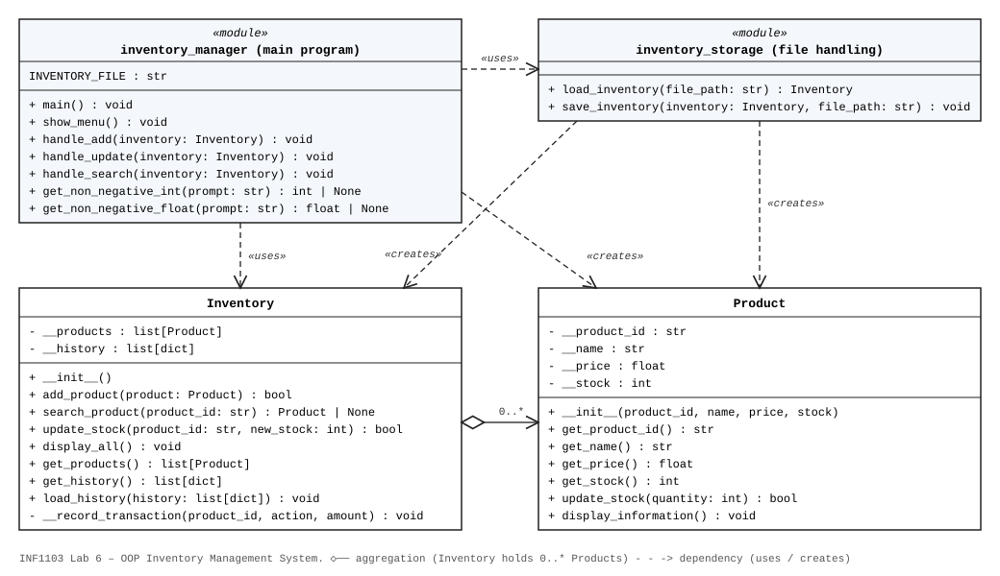

# INF1103 Lab 6 – Basics of Object-Oriented Programming

## Files

| File | Responsibility |
|------|----------------|
| `product.py` | `Product` class – stores one product's information and manages its own stock |
| `inventory.py` | `Inventory` class – stores, adds, searches, updates and displays a collection of `Product` objects (and keeps the transaction history) |
| `inventory_storage.py` | File handling – loads `inventory.json` into an `Inventory` and saves it back |
| `inventory_manager.py` | Main program – shows the menu, gets user input and calls the `Inventory` methods |
| `Dockerfile.inventory` | Docker image for the program |
| `uml_class_diagram.svg` / `.png` | UML class diagram |

## UML Class Diagram



## Running with Docker

```powershell
docker build -f Dockerfile.inventory -t inf1103-labs-inventory .
docker run --rm -it -v "${PWD}:/app" -w /app inf1103-labs-inventory
```

The project folder is mounted at `/app`, so code changes and `inventory.json` are picked up
without rebuilding the image. A rebuild is only needed if the Dockerfile changes.

## Reflection Questions

**1. What is the difference between a class and an object?**
A class is the blueprint: it defines which attributes and methods something will have.
An object is one actual instance created from that blueprint, with its own attribute values.
`Product` is the class; `Product("P001", "Laptop", 1200.00, 15)` creates a Product object.

**2. Why is Product a suitable class for this system?**
Products are the main "thing" the inventory system works with. Each product has its own data
(ID, name, price, stock) and its own behaviour (updating stock, displaying itself), so it makes
sense to bundle that data and behaviour together in one class rather than in a loose dictionary.

**3. What data belongs inside a Product object?**
The product ID, name, price and stock quantity: `__product_id`, `__name`, `__price` and `__stock`.

**4. Why should the Product class manage its own stock rather than the main program directly changing it?**
If the main program sets the stock directly, nothing stops it from setting an invalid value
such as `-5` or `"abc"`. Going through `update_stock()` lets the Product validate the value
before it changes `__stock`, so a Product can never end up in an invalid state. Any future rule
(for example, logging or low-stock warnings) only has to be added in one place.

**5. What does encapsulation mean in your program?**
Each class keeps its data private (`__products`, `__stock`, etc.) and only exposes public methods
to work with it. The main program never touches a product's attributes or the inventory's list
directly. It calls methods such as `inventory.add_product()`, `inventory.update_stock()` and
`product.get_name()`. `Inventory.get_products()` even returns a copy of the list, so outside
code cannot add or remove products behind the Inventory's back.

**6. What is the responsibility of the Product class?**
To represent and manage a single product: store its information and control changes to its own state.

**7. What is the responsibility of the Inventory class?**
To manage a collection of Product objects: store them, add new ones (rejecting duplicate IDs),
search for them, update their stock and display them all.

**8. How does separating these responsibilities demonstrate the Single Responsibility Principle?**
Each part of the program has one reason to change. If how a product is displayed changes, only
`Product` changes. If the way products are stored or searched changes, only `Inventory` changes.
If the file format changes, only `inventory_storage.py` changes. If the menu changes, only
`inventory_manager.py` changes. In Week 5 all of these lived in one file of functions.

**9. What information does the main program need to know about a Product?**
Only what is needed to create one (ID, name, price, stock) and the public methods it can call:
the getters (`get_name()`, `get_stock()`, `get_product_id()`), `update_stock()` and
`display_information()`.

**10. What information about the internal implementation of Product does the main program not need to know?**
How the data is stored internally (the private `__` attribute names and types), how
`update_stock()` validates a value, and how `display_information()` formats its output.
These could all change without the main program needing to change.
